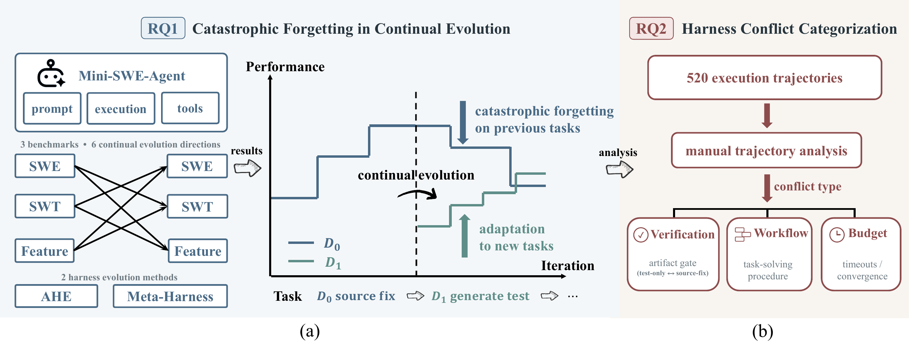
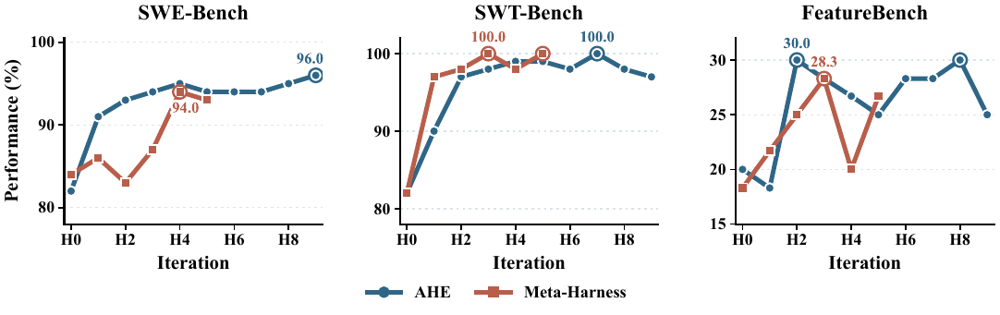
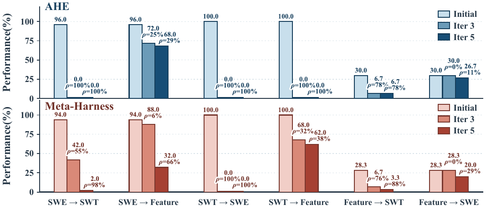
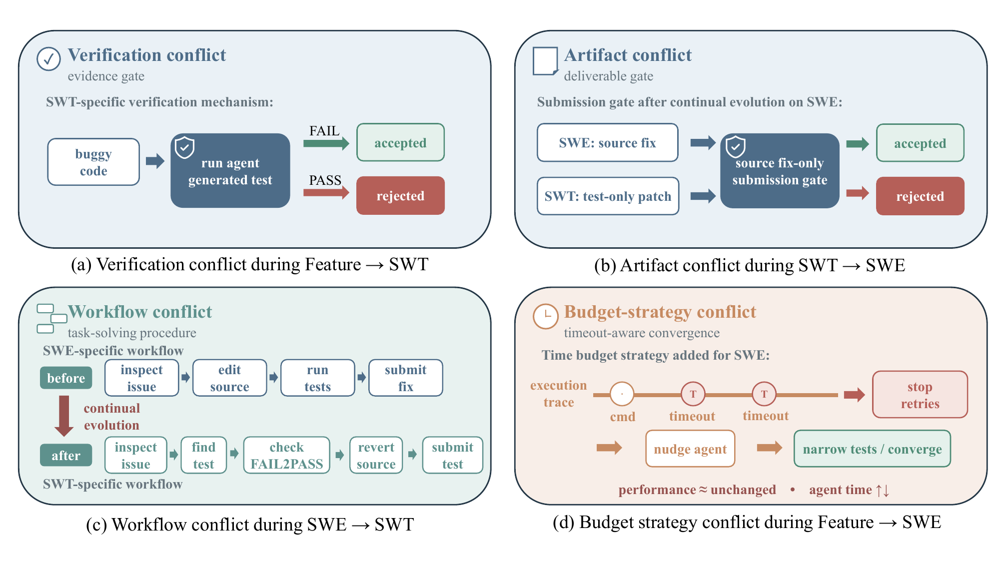

# Can Coding Agents Sustain Continual Evolution Without Forgetting?

This repository contains the code, data splits, and experiment configurations for our empirical study of **continual harness self-evolution**: successively evolving a coding agent's harness across different software-engineering task types, and measuring whether capabilities acquired on earlier tasks are preserved.

<p align="center">
  
</p>

**Key findings.**

- Both evaluated self-evolution methods (AHE and Meta-Harness) substantially improve a Mini-SWE-Agent harness when evolving on a single dataset.
- Continuing evolution on a second task type causes **catastrophic forgetting** on the first.
- From 520+ manually analyzed trajectories, forgetting is driven mainly by three kinds of harness-level conflicts: **verification**, **workflow**, and **budget strategy**.

## Repository Structure

```text
continual-evolution/
├── agentic-harness-engineering/     # AHE, adapted to evolve Mini-SWE-Agent on Harbor + E2B
│   ├── evolve.py                    # Main evaluate → analyze → evolve loop
│   ├── adapters/                    # Harbor agent / E2B environment adapters for Mini-SWE-Agent
│   ├── agents/evolve_agent/         # Evolve agent, prompts, and the mini-swe-evolution-guide skill
│   ├── configs/experiments/         # Experiment configs (one per dataset or transfer direction)
│   ├── configs/mini_swe/            # Evaluation lock and workspace policy shared by both methods
│   └── scripts/                     # Launch, resume, evaluation, and transfer-seed tooling
├── meta-harness/
│   └── reference_examples/mini_swe_harbor/   # Meta-Harness, adapted to Mini-SWE-Agent
│       ├── meta_harness.py          # Outer search loop
│       ├── proposer_backend.py      # LiteLLM-based proposer (DeepSeek or any OpenAI-compatible model)
│       ├── configs/evolution/       # Experiment configs (one per dataset or transfer direction)
│       ├── configs/suites/          # Task suites (search sets and one-task smoke tests)
│       └── scripts/                 # Launch scripts
├── mini-swe-agent-seed/             # Initial harness H0 (Mini-SWE-Agent v2.4.6 with a tool registry)
├── third_party/harbor/              # Patch turning official Harbor 0.8.0 into the HarnessFix Harbor tree
├── third_party/nexau/               # Vendored NexAU v0.3.9 (agent framework used by the AHE evolve agent)
├── requirements/                    # Exact lock files for the two Python environments
├── datasets/                        # Task splits used in all experiments (Harbor task format)
│   ├── swebench-verified/           # 50 tasks
│   ├── swtbench-verified-paraphrase/# 50 tasks (paraphrased prompt template)
│   └── featurebench/                # 30 tasks
└── assets/                          # Figures
```

## Study Setup

| Item | Setting |
|---|---|
| Initial harness (H0) | [Mini-SWE-Agent](https://github.com/SWE-agent/mini-swe-agent) v2.4.6, extended with a tool registry so that evolvers can add or modify tools |
| Evolvable surface | `src/minisweagent/config/mini.yaml` (prompts), `src/minisweagent/agents/**` (control flow), `src/minisweagent/models/utils/**` (tools, parsers, observations) |
| Frozen surface | Model provider, model identity and sampling, step/time budgets, environment, runner, datasets, verifiers (`configs/mini_swe/workspace_policy.yaml`, `evaluation_lock.yaml`) |
| Foundation model | DeepSeek-V4-Flash for both task execution and harness evolution, temperature 0 |
| Rollouts | 2 per task per round; 250 steps and 30 min wall-clock per rollout |
| Sandbox | E2B, 1 h sandbox lifetime |
| Evolution rounds | AHE: 9 rounds of evolution (10 evaluated harnesses); Meta-Harness: 5 rounds |
| Datasets | [SWE-bench Verified](https://www.swebench.com) (50), [SWT-bench](https://swtbench.com) paraphrased (50), [FeatureBench](https://github.com/LiberCoders/FeatureBench) (30) |

Both methods share the same evaluation lock, workspace policy, task lists, and Harbor adapter, so scores are directly comparable.

**Datasets.** `datasets/*/task_names.txt` lists the tasks; `datasets/*/tasks/` holds the full Harbor task directories. SWE-bench tasks match the official Harbor content hashes. SWT-bench tasks differ from Harbor dataset commit `e39578f9f952caa51cd6c0de04f125254102994a` only in the paraphrased `instruction.md` wrapper (the original template is identical across tasks and could act as a shortcut). FeatureBench tasks are a Harbor-format conversion of the official parquet (revision `e99d6efdfe511ea832c1b5735c536129561ec96a`).

## Installation

### Requirements

- Linux with Python 3.13 (AHE) and Python 3.12 (Harbor / Meta-Harness)
- [uv](https://docs.astral.sh/uv/)
- An [E2B](https://e2b.dev) account (up to 20 concurrent sandboxes)
- A DeepSeek API key (or another OpenAI-compatible endpoint)

### Runtime layout

Python environments and external sources live next to this repository in `runtime/`, not inside it:

```text
<workdir>/
├── continual-evolution/          # this repository
└── runtime/
    ├── ahe-venv/                 # Python 3.13: AHE + NexAU
    ├── harbor-venv/              # Python 3.12: Harbor + E2B + Mini-SWE-Agent
    ├── harbor/                   # Official Harbor 0.8.0 source with the HarnessFix patch applied
    └── mini-swe-agent-seeds/     # Transferred seeds: ahe/<source>-to-<target>, meta-harness/<source>-to-<target>
```

Every path can be overridden with an environment variable: `HARNESS_RUNTIME_DIR`, `AHE_PYTHON`, `META_HARBOR_RUNNER_PYTHON`, `META_HARBOR_SOURCE_DIR`, `MINI_SWE_SEEDS_DIR`, `DATASETS_ROOT`.

### Setup

Both methods run Mini-SWE-Agent through Harbor's `host_bridge` mode: the (evolved) agent code runs on the host, and every shell command it issues is executed inside the task's E2B sandbox. This mode is not part of the official Harbor release. We use the Harbor tree shipped with [HarnessFix](https://github.com/HarnessFix/HarnessFix) (`task_agent/terminal_bench_agent/harbor`, commit `9167a0b`), which is official Harbor 0.8.0 plus the changes in [`third_party/harbor/`](third_party/harbor/):

- `harnessfix-harbor-0.8.0.patch`: adds `host_bridge` / `HarborMiniEnvironment` to `agents/installed/mini_swe_agent.py` and trims the agent registry in `agents/factory.py` and `models/agent/name.py`;
- `apply_patch.sh`: applies the patch and removes the agent modules that are no longer registered.

The patched tree is byte-identical to HarnessFix's Harbor source.

```bash
mkdir -p ../runtime && cd ../runtime

# Official Harbor 0.8.0 source + HarnessFix patch
curl -L -o harbor-0.8.0.tar.gz \
  https://files.pythonhosted.org/packages/source/h/harbor/harbor-0.8.0.tar.gz
tar xzf harbor-0.8.0.tar.gz && mv harbor-0.8.0 harbor
bash ../continual-evolution/third_party/harbor/apply_patch.sh harbor

# Both environments are installed from exact lock files (requirements/*.txt) frozen
# from the environments used for the paper experiments. --no-deps installs exactly
# the listed versions; unpinned installs pull newer releases that break NexAU/Harbor.

# Harbor / Meta-Harness environment (Python 3.12). It only provides dependencies:
# at run time both methods put the patched runtime/harbor/src and the evaluated
# candidate's src/ first on PYTHONPATH.
uv venv harbor-venv --python 3.12
uv pip install --python harbor-venv/bin/python --no-deps \
    -r ../continual-evolution/requirements/harbor-venv.txt

# AHE environment (Python 3.13). NexAU's upstream repository is no longer public,
# so v0.3.9 is vendored in third_party/nexau.
uv venv ahe-venv --python 3.13
uv pip install --python ahe-venv/bin/python --no-deps \
    -r ../continual-evolution/requirements/ahe-venv.txt
uv pip install --python ahe-venv/bin/python --no-deps \
    ../continual-evolution/third_party/nexau \
    ../continual-evolution/agentic-harness-engineering/agents/evolve_agent/skills/agent-debugger-cli/_source
```

### Credentials

Create `continual-evolution/.env` (git-ignored; see `agentic-harness-engineering/.env.example`):

```bash
DEEPSEEK_API_KEY=...                        # task-execution model (evaluation lock)
LLM_API_KEY=...                             # evolver / analysis model
LLM_BASE_URL=https://api.deepseek.com
LLM_MODEL=deepseek-v4-flash                  # sent to the API verbatim, no provider prefix
E2B_API_KEY=...
```

Alternatively, point `HARNESS_ENV_FILE` to another env file.

## Running Experiments

All commands are run from the repository root. Each method has one config per setting, named `<dataset>` or `<source>-to-<target>`:

| Setting | AHE (`agentic-harness-engineering/configs/experiments/`) | Meta-Harness (`meta-harness/reference_examples/mini_swe_harbor/configs/evolution/`) |
|---|---|---|
| SWE-bench | `swebench.yaml` | `swebench.yaml` |
| SWT-bench | `swtbench.yaml` | `swtbench.yaml` |
| FeatureBench | `featurebench.yaml` | `featurebench.yaml` |
| SWE → SWT | `swebench-to-swtbench.yaml` | `swebench-to-swtbench.yaml` |
| SWE → Feature | `swebench-to-featurebench.yaml` | `swebench-to-featurebench.yaml` |
| SWT → SWE | `swtbench-to-swebench.yaml` | `swtbench-to-swebench.yaml` |
| SWT → Feature | `swtbench-to-featurebench.yaml` | `swtbench-to-featurebench.yaml` |
| Feature → SWE | `featurebench-to-swebench.yaml` | `featurebench-to-swebench.yaml` |
| Feature → SWT | `featurebench-to-swtbench.yaml` | `featurebench-to-swtbench.yaml` |

### Sanity check (no model or E2B calls)

```bash
bash agentic-harness-engineering/scripts/evaluate_mini_swe_workspace_harbor.sh \
  --workspace mini-swe-agent-seed --preset swebench-verified --dry-run
```

### AHE

```bash
cd agentic-harness-engineering

# Single-dataset evolution (runs in a tmux session)
./scripts/evolve.sh configs/experiments/swebench.yaml

# Continual evolution from a transferred seed
./scripts/evolve.sh configs/experiments/swebench-to-swtbench.yaml

# Resume an interrupted experiment
./scripts/evolve.sh --experiment <experiment_dir_name> --start-iteration <N> configs/experiments/swebench.yaml
```

Results are written to `agentic-harness-engineering/experiments/<timestamp>__<name>/`, including per-iteration Harbor jobs, trajectories, analysis reports, and `scores.md`.

### Meta-Harness

Each setting has a launch script, `scripts/run_<setting>.sh` (e.g., `run_swebench.sh`, `run_swebench_to_swtbench.sh`), which runs 5 iterations with 2 trials per task, 20 concurrent sandboxes, and the DeepSeek-V4-Flash proposer:

```bash
cd meta-harness/reference_examples/mini_swe_harbor

# Single-dataset evolution (run name defaults to the setting name)
bash scripts/run_swebench.sh

# Continual evolution from a transferred seed
bash scripts/run_swebench_to_swtbench.sh

# Custom run name
bash scripts/run_swebench_to_swtbench.sh my-run
```

Re-running a script with the same run name resumes the run. Results are written to `runs/<run-name>/` (`frontier.json`, `evolution_summary.jsonl`, frozen candidate snapshots, and Harbor evaluations).

### Continual-evolution protocol

1. Evolve independently on each dataset starting from H0.
2. Take the best harness of each run (the earliest one on ties) as the seed for the next dataset. For AHE, `scripts/bootstrap_cross_dataset_mini_swe.py` produces a clean seed and its provenance file. Seeds are stored under `runtime/mini-swe-agent-seeds/ahe/<source>-to-<target>` and `runtime/mini-swe-agent-seeds/meta-harness/<source>-to-<target>`; the two methods use different seeds because each starts from its own best source harness.
3. Continue evolving on the target dataset with the corresponding `<source>-to-<target>` config.
4. Re-evaluate the intermediate harnesses on the **source** dataset to measure forgetting:

```bash
bash agentic-harness-engineering/scripts/evaluate_mini_swe_workspace_harbor.sh \
  --workspace <path-to-evolved-workspace> --preset swebench-verified --attempts 2
```

Forgetting is reported as the absolute drop Δ = Eval(H<sub>src</sub>, D<sub>src</sub>) − Eval(H<sub>cont</sub>, D<sub>src</sub>) and the relative drop ρ = Δ / Eval(H<sub>src</sub>, D<sub>src</sub>).

## Results

Our experiments were conducted using `DeepSeek-V4-Flash-0731`. Results may differ when using the current version of the Flash model.

### Single-dataset evolution

<p align="center">
  
</p>

Pass rate (%) on each sampled split. H0 is reported separately for the AHE / Meta-Harness runs where the two baselines differ.

### Continual evolution: forgetting on the source dataset

<p align="center">
  
</p>

Source-dataset pass rate (%) of the best source harness (Initial) and after 5 rounds of evolution on the target dataset; ρ is the relative drop.

Forgetting is smaller between closely related tasks (SWE-bench ↔ FeatureBench, both of which modify source code) and much larger whenever SWT-bench (test generation) is involved.

### Harness conflicts behind forgetting

<p align="center">
  
</p>

Injecting a single conflict type into the best SWE-bench harness (AHE):

| Harness configuration | SWE-bench (%) | Agent time (s) |
|---|---|---|
| Best SWE-bench harness | 96.0 | 245.5 |
| + Verification conflict | 0.0 (↓100%) | 415.7 (↑69%) |
| + Workflow conflict | 66.0 (↓31%) | 821.5 (↑235%) |
| + Budget strategy | 96.0 (↓0%) | 439.7 (↑79%) |

Verification conflicts (e.g., a submission gate that rejects any change outside test files) can disable a previously solved task type entirely; workflow conflicts degrade both accuracy and efficiency; budget strategies mainly affect execution time.

## Acknowledgements

This work builds on the following open-source projects. Their original licenses are kept in the respective subdirectories.

- [Agentic Harness Engineering (AHE)](https://github.com/china-qijizhifeng/agentic-harness-engineering) — `agentic-harness-engineering/` (MIT)
- [Meta-Harness](https://github.com/stanford-iris-lab/meta-harness) — `meta-harness/` (MIT)
- [Mini-SWE-Agent](https://github.com/SWE-agent/mini-swe-agent) — `mini-swe-agent-seed/` (MIT)
- [HarnessFix](https://github.com/HarnessFix/HarnessFix) — the Harbor `host_bridge` integration for Mini-SWE-Agent (`third_party/harbor/`)
- [NexAU](https://github.com/nex-agi/NexAU) — the agent framework behind the AHE evolve agent; v0.3.9 is vendored in `third_party/nexau/` (Apache-2.0)
- [Harbor](https://github.com/laude-institute/harbor) and [E2B](https://e2b.dev) for task execution
- [SWE-bench](https://www.swebench.com), [SWT-bench](https://swtbench.com), and [FeatureBench](https://github.com/LiberCoders/FeatureBench) for the evaluation tasks

## Citation

```bibtex
@article{continual-harness-evolution,
  title  = {Can Coding Agents Sustain Continual Evolution Without Forgetting?},
  author = {Anonymous},
  year   = {2026}
}
```
